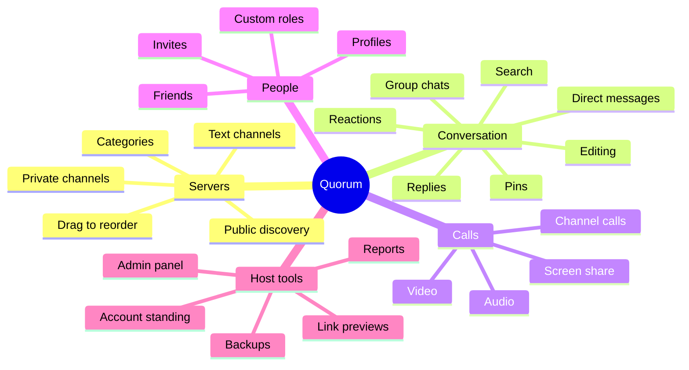
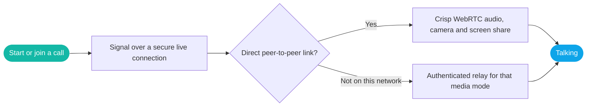
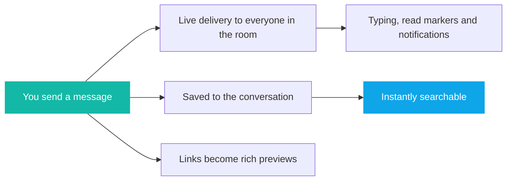

 

*A self-hosted community platform for conversation, calls and connection: warm, fast and entirely yours.*

---

> **A showcase repository.** It contains no source code, only a tour of what Quorum is and the experience it creates. See the [milestone timeline](VERSIONS.md) for how it grew.

## The idea

Great communities deserve a place of their own. Quorum gives you a beautiful, familiar space for your friends, team or fans to gather, hosted by you, shaped by you, and owned by you. Servers with channels and categories, private conversations, live voice, video and screen sharing, a thoughtful roles system, and a full admin panel all live in one cohesive app, in light and dark themes, with calm, purposeful motion.

## The shape of a community

## Welcoming someone new

## Every call finds a way through

## How a message travels

## Everything Quorum can do

### Servers and channels

| | Feature | What it feels like |
|---|---|---|
| 🏰 | **Create your own server** | A home for your community in a few clicks, with a custom icon |
| 💬 | **Text channels** | Every topic neatly in its place |
| 🗂️ | **Categories** | Group channels so even big servers stay tidy |
| 🔒 | **Public and private channels** | Open to all members, or limited to chosen people and roles |
| 🧭 | **Server discovery** | Browse public servers and join the ones that fit |
| 🧲 | **Drag-and-drop server order** | Arrange your server strip exactly how you like it |
| ⚙️ | **Server settings** | Rename, restyle and reshape channels, categories and access in one place |
| 🔊 | **Channel calls** | Hop into a shared voice or video room right inside a server |

### Messaging

| | Feature | What it feels like |
|---|---|---|
| ✉️ | **Direct messages** | One-to-one conversations, always a click away |
| 👥 | **Group chats** | Bring a few friends together and add people along the way |
| ↩️ | **Replies** | Answer a specific message with its context beside it |
| 💖 | **Reactions** | Celebrate the good moments with a tap |
| 📌 | **Pins** | Keep the important things close |
| ✏️ | **Edit and delete** | Fix a typo or take a message back |
| ⌨️ | **Typing indicators** | See when someone is writing to you |
| 👀 | **Read and unread markers** | Know exactly where you left off |
| 🟢 | **Live presence and custom status** | See who is around and what they are up to |
| 💌 | **Invite cards** | Server invites that appear as friendly cards right in chat |
| 🪄 | **Composer that protects your words** | If a send hiccups, your message stays put and a friendly toast lets you know |

### Calls

| | Feature | What it feels like |
|---|---|---|
| 🎧 | **Audio calls** | Clear, low-latency voice |
| 📹 | **Video calls** | Face to face with your people |
| 🖥️ | **Screen sharing** | Show what you are working on |
| 👨‍👩‍👧 | **One-to-one, group and channel calls** | Private catch-ups or a whole server in one room |
| 📡 | **Smart connection** | WebRTC first, with an authenticated relay fallback per media mode so calls keep going |
| 🔁 | **Reconnect grace** | A brief network blip will not drop your call |
| 📞 | **Call bar and ringtones** | Accept, reject, mute and hang up from a tidy control bar |
| 📵 | **Missed-call history** | Missed calls are recorded in the conversation |
| 🎙️ | **Voice messages** | Record a clip and send it in chat |

### Friends, invites and roles

| | Feature | What it feels like |
|---|---|---|
| 🤝 | **Friends** | Send, accept and manage friend requests, and find people by username |
| 🎟️ | **Expiring invites** | Links with an optional expiry and maximum number of uses |
| 🧾 | **Invite landing page** | A welcoming preview before anyone joins |
| 🎭 | **Built-in and custom roles** | Create roles with their own permissions and assign them to members |
| 🧩 | **Permission control** | Roles govern who can view, send, manage and moderate |
| 🗝️ | **Per-person and per-role channel access** | Fine-grained private channels for teams, staff or VIPs |
| 👤 | **Profile cards** | Click a name to see avatar, banner, status and details |
| 🚫 | **Blocking** | Step away from anyone with one action |

### Moderation and admin

| | Feature | What it feels like |
|---|---|---|
| 🛡️ | **Dedicated admin panel** | A separate, protected control room for the host |
| 📊 | **Overview dashboard** | Recent activity, users and calls at a glance |
| 👥 | **User directory** | Filter by presence and account standing |
| ⚖️ | **Account standing** | Suspend temporarily or ban permanently, with reasons and durations |
| 🚩 | **Reports** | Members can report messages; admins review them in a dedicated queue |
| 🗑️ | **Deleted-message review** | Moderators can see what was removed and clear content when needed |
| 📞 | **Live calls and online users** | See who is connected right now |
| 🔨 | **Server moderation** | Remove members, ban and unban, manage roles and invites |
| 🧹 | **Tidy storage** | Deleting a server, channel or message cleans up its media too |
| 🤗 | **Clear account notices** | Members see a considerate standing screen and warning dialogs |

### Search

| | Feature | What it feels like |
|---|---|---|
| 🔎 | **Message search** | Search conversations and server channels by words |
| 📎 | **Filename search** | Find that file by its name |
| 🙋 | **Search by sender** | Narrow results to one person |
| ⚡ | **Built for large histories** | Full-text indexing keeps results quick as your archive grows |
| 📜 | **Paged results and load more** | Newest first, with easy browsing back through time |

### Links, files and media

| | Feature | What it feels like |
|---|---|---|
| 🔗 | **Rich link previews** | Shared links unfurl into titles, descriptions and images |
| 🖼️ | **Image and file uploads** | Drop in pictures, documents and more |
| 🎤 | **Voice uploads** | Share recorded audio |
| 🔐 | **Members-only attachments** | Files are only visible to the people in the conversation |
| 🧑‍🎨 | **Avatars and banners** | Make your profile your own |

### Personalization and notifications

| | Feature | What it feels like |
|---|---|---|
| 🌗 | **Light and dark themes** | Both carefully tuned, with your choice remembered |
| ✨ | **Calm, purposeful motion** | Smooth transitions that respect reduced-motion preferences |
| 🔔 | **Desktop notifications** | Opt in to alerts for new messages |
| 👀 | **Typing indicator control** | Choose whether to show when you are typing |
| 🔏 | **Privacy settings** | Decide what others can see about you |
| 🪪 | **Account settings** | Update username, email, password, avatar, banner and custom status |
| ♿ | **Accessible by design** | Focus management in dialogs, visible focus rings and keyboard-friendly controls |
| 📱 | **Responsive layout** | Comfortable on desktop and narrow screens |

### Hosting made gentle

| | Feature | What it feels like |
|---|---|---|
| 🧭 | **Smooth first run** | The database creates and upgrades itself automatically |
| 💾 | **One-command backups** | Consistent snapshots with built-in integrity checks |
| 🩺 | **Health and readiness checks** | Easy to monitor from your process supervisor |
| 🌙 | **Graceful shutdown** | Active calls and connections wrap up cleanly |
| 🧪 | **Real-server test suite** | Tests boot a genuine server against an isolated temporary database |

## What shipped, at a glance

| Area | Highlights |
|---|---|
| Servers | Channels, categories, discovery, private access, roles, invites, ordering |
| Conversation | DMs, groups, replies, reactions, pins, edits, uploads, voice notes, previews |
| Calls | Audio, video, screen share, channel calls, WebRTC with relay fallback |
| Community care | Reports, standing, warnings, admin panel, blocking |
| Experience | Light and dark themes, motion language, notifications, accessibility |

## Why you'll love hosting it

| | |
|---|---|
| 🏡 **Yours, fully** | Self-hosted, so your community and its memories stay in your hands |
| ⚡ **Light and quick** | Designed to run happily on modest hardware |
| 🧭 **Ready in minutes** | A smooth first-run setup gets you from nothing to a thriving server fast |
| 🛡️ **Care built in** | Thoughtful access control, members-only files and a dedicated admin panel |

## Built with

React and Vite on the front, Node.js and Express with Socket.IO for live delivery, SQLite for storage, and WebRTC for calls.

---

**Quorum** · crafted by [Zenix Developers](https://github.com/Zenix-Developers) · [zenix.sg](https://zenix.sg)

*The source code is private. Interested in a closer look? Get in touch.*

