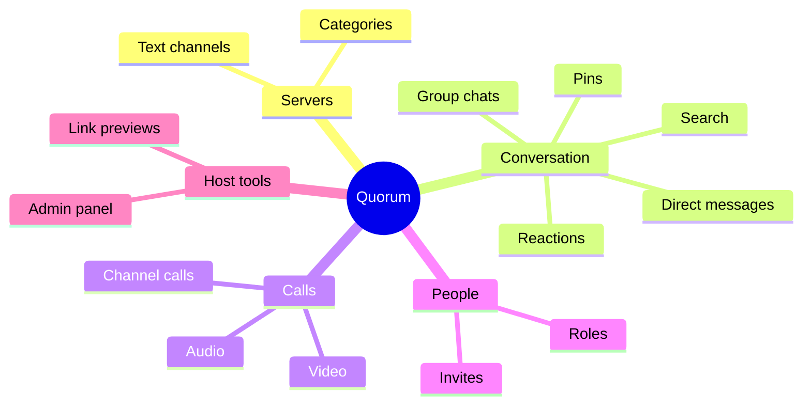

 

*A self-hosted community platform for conversation, calls and connection: warm, fast and entirely yours.*

---

> **A showcase repository.** It contains no source code, only a tour of what Quorum is and the experience it creates.

## The idea

Great communities deserve a place of their own. Quorum gives you a beautiful, familiar space for your friends, team or fans to gather, hosted by you, shaped by you, and owned by you.

## The shape of a community

## Welcoming someone new

## What it feels like

| | Feature | What it feels like |
|---|---|---|
| 💬 | **Channels and categories** | Every conversation neatly in its place |
| ✉️ | **Direct and group chats** | For the closer moments |
| 🎧 | **Audio and video calls** | Crystal clear, in private chats or shared channels |
| 🎟️ | **Invites and roles** | Welcoming people, and looking after them, is simple |
| 💖 | **Reactions and pins** | Celebrate the good things and keep them close |
| 🔎 | **Message search** | Find any moment again |
| 🔗 | **Rich link previews** | Shared content comes to life |
| 🛡️ | **Built-in admin panel** | Everything a host needs to keep things running smoothly |

## Why you'll love hosting it

| | |
|---|---|
| 🏡 **Yours, fully** | Self-hosted, so your community and its memories stay in your hands |
| ⚡ **Light and quick** | Designed to run happily on modest hardware |
| 🧭 **Ready in minutes** | A smooth first-run setup gets you from nothing to a thriving server fast |

---

**Quorum** · crafted by [Zenix Developers](https://github.com/Zenix-Developers)

*The source code is private. Interested in a closer look? Get in touch.*

